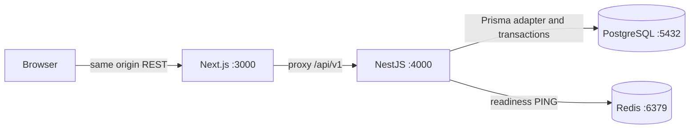

# Architecture

Local pnpm monorepo, Next.js App Router + NestJS modular monolith. Browser requests
use same-origin /api/v1 proxy; TanStack Query stores server state, Zod validates
responses, Zustand holds UI state and memory-only access token. Inter is local.

Implemented modules: configuration, health, monitoring, database, auth, users,
organizations, events, booking/orders and realtime. Guards default-deny and enforce JWT sessions/roles. Organization
service checks membership with explicit ADMIN bypass. Controllers handle DTO/HTTP;
services own transactions. Frontend gates provide loading/error/denial UX.

AuthProvider abstracts local JWT authentication. Access JWT validates algorithm,
issuer/audience/expiry/type; DB decides current role, account and session activity.
Bcrypt cost 12 hashes passwords outside transactions. Random refresh tokens are
hash-only in DB, rotated transactionally, sent through HttpOnly cookies. Replay
revokes a session; logout/password change revoke sessions. Hard session age is enforced.

Frontend refresh uses one in-tab promise and Web Locks across tabs to avoid cookie
reuse. Epoch checks reject stale bootstrap results. Query cache clears on identity
change. Tokens never persist in browser storage. Without Web Locks, concurrent
refresh fails closed and may require login again.

Helmet, CORS whitelist, validation, per-process throttle, request IDs, sanitized
logs/errors and Swagger are configured. Metrics/Swagger remain disabled in production.
Health queries actual PostgreSQL/Redis with timeouts; local metrics measure HTTP,
booking outcomes, valid held seats and live Socket.IO connections. Redis provides
the optional Socket.IO adapter; PostgreSQL owns authentication and reservations.

PostgreSQL 17/Redis 7.4 run in Docker, loopback ports, persistent dev volumes. Test
stack uses 55432/56379 and PostgreSQL tmpfs. Domain schema prepares later phases;
seed only runs development/test. No business dashboards are hardcoded.

## Event management (Phase 3)

EventsModule contains separate public/organizer/admin controllers, validated DTOs,
lifecycle policy, draft/grid/review/staff services and shared record projection.
Organizer writes require membership in an approved organization. Review belongs to
ADMIN; public reads require published events and approved organizations. Rows are
locked during lifecycle changes, preventing concurrent grid edits from invalidating
a submitted event. Audit is stored inside the same transaction.

Frontend uses real catalog, organizer aggregates, editable draft forms, seat grid,
staff assignments and admin review/history APIs. URL filters, pagination, validation,
confirm dialogs and server errors are handled without mocked business responses.
Image URLs render directly in browsers without server image fetching/optimization.

Read snapshots include inventory revision for the upcoming realtime phase. Phase 4 now implements Socket.IO broadcasts and reservation endpoints. API/database remain the
source of truth. Detailed analytics and admin system dashboards are still planned.

## Remaining phases

- Phase 5: PaymentProvider, signed local mock callbacks, atomic/idempotent sale/order/
  ticket finalization, opaque QR. Late payment requires refund, never reclaims sold seats.
- Phase 6: staff-event authorization, atomic VALID → USED check-in and aggregates.
- Phase 7: Redis Lua admission prototype, concurrency/E2E coverage, measured load.

Do not wait for Redis/payment/email in database transactions. Persist before realtime
publication. Add durable outbox/job interface when needed; BullMQ and future SQS
need distinct adapters and retry/idempotency semantics.

Future adapters may target Cognito, RDS/Aurora, ElastiCache, S3, SQS, ECS, CloudWatch.
No AWS resources are provisioned and no AWS SDK is required for local execution.

## Booking and realtime (Phase 4)

BookingModule contains DTO/policy/lock helpers, atomic hold service, owner snapshots,
release/reconciliation and order creation. InventoryPublisher separates domain
transactions from Socket.IO. The global RealtimeModule authenticates rooms and
optionally uses Redis Pub/Sub across instances. Domain services emit only after
commit; delivery failure does not undo committed ownership. Redis/Socket payloads
never authorize a purchase.

Frontend selection is transient Zustand state, distinct from PostgreSQL holds.
Confirmation, idempotent retries, server-based countdown and reload snapshots keep
ownership explicit. Map colors reflect private effective states; stale REST and
out-of-order event revisions cannot replace newer snapshots. Periodic REST sync
covers missed emissions and reconnect. Checkout is a pending order, not payment.

Local scheduler runs in the API process (no BullMQ worker needed yet); each scan is
idempotent across instances and PostgreSQL remains authoritative. Startup with the
Redis adapter configured requires Redis; default single-instance mode keeps
readiness diagnostics available when dependencies fail. No AWS resources exist.

Documentation records actual execution dates. Git author/committer dates have been
explicitly reconstructed for the user's project timeline; see commit-timeline.md.
