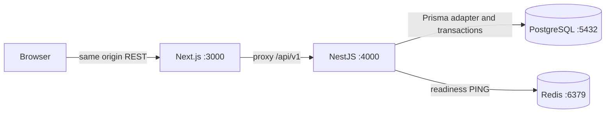

# Architecture

Local pnpm monorepo, Next.js App Router + NestJS modular monolith. Browser requests
use same-origin /api/v1 proxy; TanStack Query stores server state, Zod validates
responses, Zustand holds UI state and memory-only access token. Inter is local.

Implemented modules: configuration, health, monitoring, database, auth, users,
organizations. Guards default-deny and enforce JWT sessions/roles. Organization
service checks membership with explicit ADMIN bypass. Controllers handle DTO/HTTP;
services own transactions. Frontend gates provide loading/error/denial UX.

AuthProvider abstracts local JWT authentication. Access JWT validates algorithm,
issuer/audience/expiry/type; DB decides current role, account and session activity.
Bcrypt cost 12 hashes passwords outside transactions. Random refresh tokens are
hash-only in DB, rotated transactionally, sent through HttpOnly cookies. Replay
revokes a session; logout/password change revoke sessions. Hard session age is enforced.

Frontend refresh uses one in-tab promise and Web Locks across tabs to avoid cookie
reuse. Epoch checks reject stale bootstrap results. Query cache clears on identity
change. Tokens never persist in browser storage. Without Web Locks, concurrent
refresh fails closed and may require login again.

Helmet, CORS whitelist, validation, per-process throttle, request IDs, sanitized
logs/errors and Swagger are configured. Metrics/Swagger remain disabled in production.
Health queries actual PostgreSQL/Redis with timeouts; metrics count HTTP only.
Redis has no auth/session business role yet.

PostgreSQL 17/Redis 7.4 run in Docker, loopback ports, persistent dev volumes. Test
stack uses 55432/56379 and PostgreSQL tmpfs. Domain schema prepares later phases;
seed only runs development/test. No business dashboards are hardcoded.

## Remaining phases

- Phase 3: event CRUD, venue/section/ticket types, grid generator, staff assignment,
  admin approval/audit. Scope organizer writes to membership.
- Phase 4: sorted PostgreSQL row locks/conditional updates, atomic holds, server TTL,
  reconciliation and Socket.IO after commit. Redis never decides ownership. REST
  snapshots reconcile missed/stale revisions.
- Phase 5: PaymentProvider, signed local mock callbacks, atomic/idempotent sale/order/
  ticket finalization, opaque QR. Late payment requires refund, never reclaims sold seats.
- Phase 6: staff-event authorization, atomic VALID → USED check-in and aggregates.
- Phase 7: Redis Lua admission prototype, concurrency/E2E coverage, measured load.

Do not wait for Redis/payment/email in database transactions. Persist before realtime
publication. Add durable outbox/job interface when needed; BullMQ and future SQS
need distinct adapters and retry/idempotency semantics.

Future adapters may target Cognito, RDS/Aurora, ElastiCache, S3, SQS, ECS, CloudWatch.
No AWS resources are provisioned and no AWS SDK is required for local execution.
