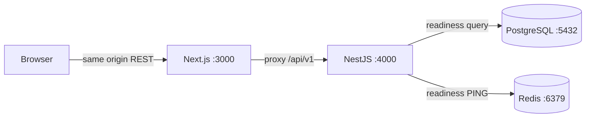

# Architecture

## Implemented in Phase 1

TixFlow is a local pnpm monorepo. Next.js App Router renders public pages and
reusable dashboard shells. TanStack Query manages server data; Zustand holds
navigation state only. Browser requests go through a same-origin Next.js proxy to
NestJS `/api/v1`. Server responses are checked with Zod before rendering.

NestJS is a modular monolith. The current modules are configuration, health and
local monitoring. Global HTTP infrastructure provides Helmet, CORS allowlist,
ValidationPipe, in-memory per-process throttling, request IDs, sanitized logging
and a consistent exception filter. Swagger is available in development/test.
Metrics and Swagger are disabled in production until authentication is added.

PostgreSQL 17 and Redis 7.4 are configured as persistent local Docker Compose
services, exposed only on loopback. Readiness executes `SELECT 1` and `PING` using
real clients with timeouts. Liveness only indicates the Node process is running.
Metrics count completed HTTP requests in this process; no distributed metric,
business KPI, queue or socket count is invented.

Dashboard routes are public **design previews** with no protected data or actions.
They are not authorization boundaries. Phase 2 must add backend authentication,
RBAC/resource ownership and frontend route protection before exposing user data.

## Planned boundaries (not implemented)

- Phase 2: Prisma persistence and migration; `AuthProvider` abstraction with local
  JWT/password implementation, hashed/revocable refresh sessions in HttpOnly cookies.
- Phase 3: organizations, venues, events, sections, ticket types, seat generator,
  staff assignment, approval and audit logs. Organization ownership in services.
- Phase 4: PostgreSQL row locks/conditional updates in stable seat ID order,
  all-or-nothing holds, server TTL, reconciliation and Socket.IO invalidations after
  commit. PostgreSQL decides ownership; Redis does not authorize sales. REST
  snapshots reconcile missed or stale socket revisions.
- Phase 5: orders, `PaymentProvider` interface, local-only signed mock callback,
  atomic/idempotent finalization and opaque QR ticket issuance. Late settlement
  requires refund handling and must never reclaim a seat sold to another order.
- Phase 6: atomic check-in conditioned on ticket status and staff event assignment;
  backend aggregate analytics.
- Phase 7: Redis Lua admission prototype, regression/concurrency/E2E tests and
  measured load tests. Admission is not a production anti-bot claim.

Database transactions must never wait on Redis, provider HTTP or email delivery.
Persist durable state before publishing realtime changes. Add a transactional
outbox/job interface when reliable asynchronous delivery is required. BullMQ and
future SQS adapters have separate retry/idempotency semantics; they are not
interchangeable clients.

Future adapters can target RDS/Aurora, ElastiCache, Cognito, S3, SQS, ECS and
CloudWatch without placing AWS SDK calls in business logic. None is provisioned
or needed for local execution.
